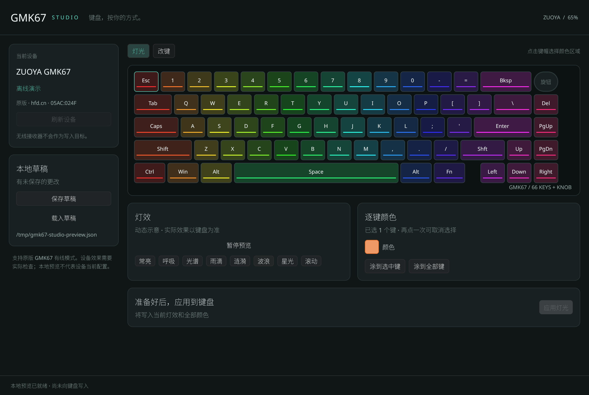
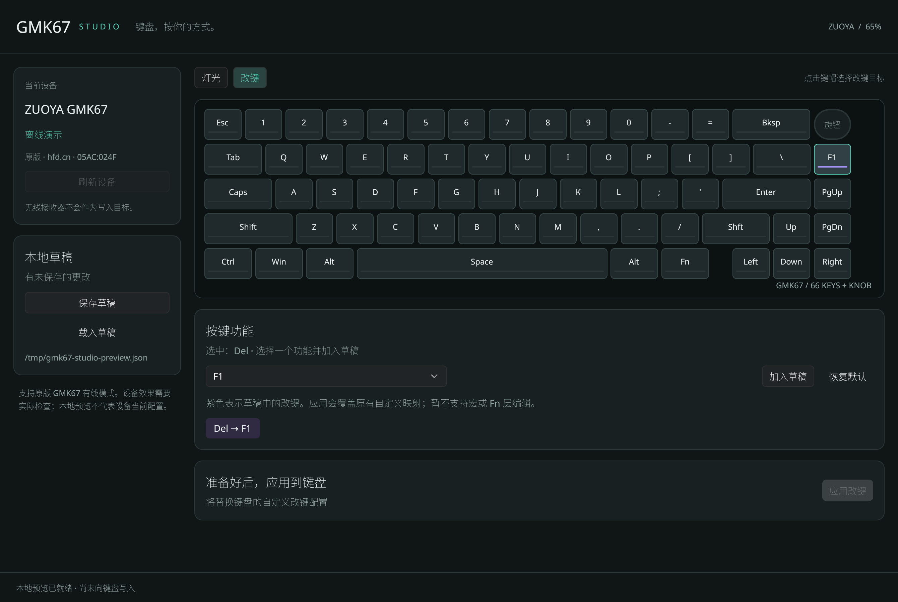

# GMK67 Studio RS

用 Rust 与 GPUI Kit 编写的原生 ZUOYA GMK67 配置工具。可点选完整 66 键与旋钮布局，动态预览八种灯效、编辑逐键颜色，搜索改键功能，并保存本地 JSON 草稿。

> 当前是可运行的首版。报文已对照参考项目并做自动化测试；尚未实际向键盘写入验证。启动、扫描、载入草稿和预览均不会写设备。





## 运行

```sh
nix develop
cargo run --locked
```

也可先 `direnv allow`，再用 `direnv exec . cargo run --locked`。开发环境锁定在 `flake.lock`，包含 Rust、sccache、GPUI 和 hidapi 所需的 Linux 库。

```sh
cargo run --locked -- --demo                 # 离线界面，不访问 HID
cargo run --locked -- --list                 # 仅列出匹配的有线设备
cargo run --locked -- --preview              # 查看草稿生成的报文，不访问 HID
cargo run --locked -- --profile ./draft.json # 使用指定的草稿文件
```

默认草稿路径为 `$XDG_CONFIG_HOME/gmk67-studio-rs/profile.json`，未设置时使用 `~/.config`。编辑发生在本地；点击应用后弹出明确的“确认写入 / 取消”按钮，确认后才写入键盘。灯光和改键分别应用。保存的草稿不是从设备读取的备份。

## 支持范围

- 当前针对原版 GMK67 **有线模式**：VID `05ac`、PID `024f`、接口 `0`，制造商 `hfd.cn`、产品 `USB DEVICE`。同 VID/PID 的 `HS6209 USB Dongle` 会被排除。该标识并非全球唯一的型号证明；请确认连接的是原版 GMK67。
- 八种灯效、完整逐键 RGB、参考协议已列出的 HID 按键功能。预览支持暂停/播放，点击键帽可触发涟漪；动画是视觉示意，未模拟未知固件算法，实际表现须以键盘为准。灯效名称沿用参考项目。
- 旋钮配置、Fn 改写、宏、独立 Fn 层、GMK67 V2、无线写入尚未支持。
- 改键会替换当前自定义映射，并依参考协议清空 `0x27` 附加块；该块含义未确认，应用前有明确提示。
- 协议没有已确认的配置读回或 ACK 签名。界面的“已发送”只说明 HID 交换完成，不能证明设置已保存；任一交换失败即停止，配置可能只写入了一部分，不自动重试。

写入需要当前用户能访问相应 `/dev/hidraw*`。若打开失败，检查针对该设备的 udev / uaccess 权限；应用不会自行修改系统配置。

## 检查与真实界面截图

在上述开发环境中执行：

```sh
cargo fmt --check
cargo test --locked --all-features
cargo clippy --locked --all-targets --all-features -- -D warnings
mkdir -p /tmp/gmk67-preview
cargo run --locked --features preview -- --snapshot /tmp/gmk67-preview/lighting.png
```

最后一条用真正的 GPUI GPU 渲染器生成灯光、动态波浪、改键与应用确认 PNG，并通过原生鼠标事件检查键帽选择、着色、改键、Fn 保护、动画帧变化、暂停、离线写入禁用、确认/取消按钮。此模式需要可用的 Vulkan 驱动，确认测试使用保证不存在的设备路径，只枚举设备并验证错误回传，不打开或写入任何 HID 设备。`--snapshot` 仅在 `preview` feature 下提供。

动画测试检查常亮稳定、七种动态效果随时间变化及点击涟漪；协议测试包含完整灯光 golden 报文、改键块顺序、等待时间、非法草稿拒绝、接收器排除与中途断连停止。

## 协议来源

协议事实来自 [shtefan4079/gmk67_devicesdriver_open](https://github.com/shtefan4079/gmk67_devicesdriver_open/tree/9cabde0de47629a117fa7a1b294dd0b752357e11)，固定提交 `9cabde0de47629a117fa7a1b294dd0b752357e11`：`ProtocolController.cpp`、`HidManager.cpp` 与 `Layout.js`。本项目独立实现 Rust 编码与界面，未引入该项目的 C++ 或 QML 源码。`tests/golden-lighting.txt` 保存参考协议的静态红色报文数据，属于源码模板推导值，并非 USB 抓包。

本项目独立代码采用 MIT 许可，不代表键盘厂商授权或官方驱动。
